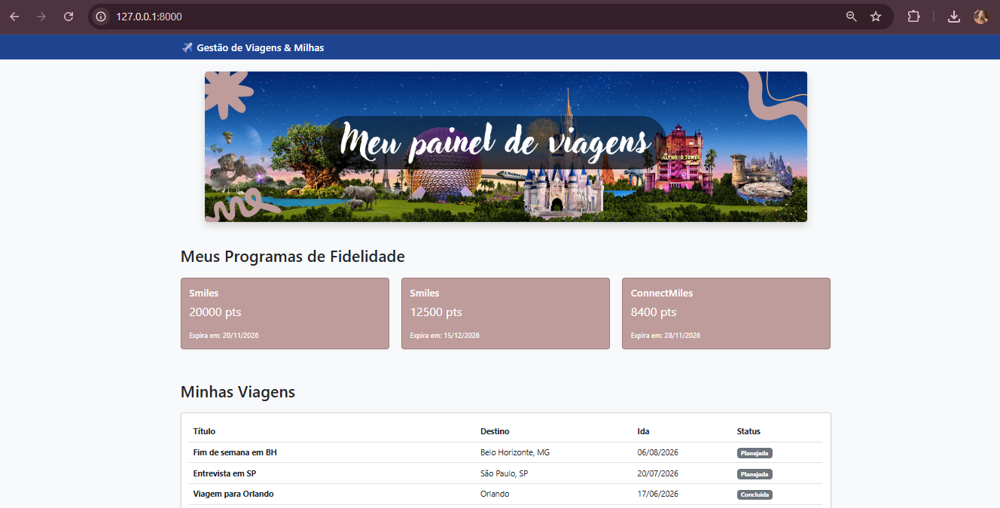
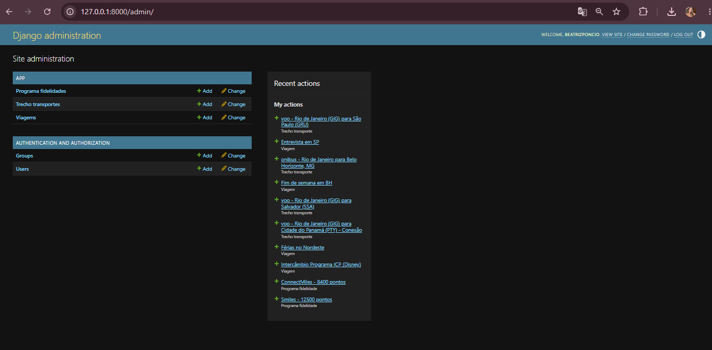

# ✈️ Plataforma de Gestão de Viagens e Milhas

## 📖 Descrição Resumida
Aplicação Web desenvolvida para centralizar a gestão de viagens futuras (voos e trechos rodoviários) e o controle de saldo e vencimento de pontos em diferentes programas de fidelidade. O sistema possui um painel administrativo dinâmico e um dashboard interativo.

## 🛠️ Tecnologias Utilizadas
* **Backend:** Python e Django (Arquitetura MVT)
* **Frontend:** HTML5, Bootstrap 5 e CSS
* **Banco de Dados:** SQLite3 (Padrão do Django)
* **Versionamento:** Git e GitHub

## 👥 Integrantes (Dupla)
* Beatriz Poncio
* Assistente IA (Dupla do Projeto)

## ⚙️ Instruções de Instalação
Siga os passos abaixo para preparar o ambiente de desenvolvimento na sua máquina:

1. Clone o repositório do projeto:
   `git clone https://github.com/SEU-USUARIO/projeto-viagens.git`
2. Acesse a pasta do projeto:
   `cd projeto-viagens`
3. Crie e ative um ambiente virtual (venv):
   `python -m venv venv`
   `.\venv\Scripts\activate` (Windows) ou `source venv/bin/activate` (Mac/Linux)
4. Instale as dependências listadas:
   `pip install -r requirements.txt`

## 🚀 Instruções de Execução
Com o ambiente configurado e ativado, execute as migrações e inicie o servidor:

1. Aplique o banco de dados:
   `python manage.py migrate`
2. Inicie o servidor local:
   `python manage.py runserver`
3. Acesse a aplicação no navegador através do endereço `http://127.0.0.1:8000/`.

## 📂 Estrutura Básica do Projeto
O projeto foi organizado seguindo as boas práticas e as exigências da disciplina de Laboratório de Desenvolvimento de Software:

```text
repositorio/
├── README.md
├── requirements.txt
├── docs/
│   ├── arquitetura.png
│   ├── banco_de_dados.png
│   ├── relatorio_final.pdf
│   └── telas/
│       ├── dashboard.png
│       └── admin.png
├── app/
├── core/
├── static/
│   └── img/
│       └── banner.jpg
├── templates/
│   └── dashboard.html
└── manage.py
```

## 📸 Prints Principais



## 📄 Documentação Completa
A documentação acadêmica detalhada contendo a fundamentação teórica, diagrama de banco de dados e detalhamento da arquitetura pode ser encontrada no arquivo PDF em: `docs/relatorio_final.pdf`.